# BoundaryPro Client

**Know who owes, who is booked, and which unit needs a mechanic before the day starts.**

The React app of BoundaryPro, a fleet and boundary management system for tricycle and jeepney operators. It is built with React, TypeScript, Vite and Tailwind CSS, and it talks to the REST API in a separate repository, `boundarypro-server`.

Advanced Web Programming (CTADWEBL), School of Architecture, Technology, and Computing, NU Clark. Final project, A.Y. 2026-2027.

## Contents

1. [Project, group and concept](#project-group-and-concept)
2. [What the application does and the data it processes](#what-the-application-does-and-the-data-it-processes)
3. [Screenshots](#screenshots)
4. [Features](#features)
5. [Tech stack](#tech-stack)
6. [Setup](#setup)
7. [Try it yourself](#try-it-yourself)
8. [Project structure](#project-structure)
9. [From React to Express to MongoDB](#from-react-to-express-to-mongodb)
10. [Pages and routes](#pages-and-routes)
11. [Forms and validation](#forms-and-validation)
12. [Design](#design)
13. [API documentation](#api-documentation)
14. [Known limitations](#known-limitations)

## Project, group and concept

| | |
|---|---|
| **System name** | BoundaryPro |
| **Tagline** | Know who owes, who is booked, and which unit needs a mechanic before the day starts. |
| **Group** | [Group name] |
| **Course and section** | CTADWEBL, [Section] |
| **Repositories** | `boundarypro-client` (this one) and `boundarypro-server` |

### Group members

| Member | GitHub account | Main contributions |
|---|---|---|
| [Member 1 full name] | [github username] | [files and features this member wrote] |
| [Member 2 full name] | [github username] | [files and features this member wrote] |
| [Member 3 full name] | [github username] | [files and features this member wrote] |
| [Member 4 full name] | [github username] | [files and features this member wrote] |
| [Member 5 full name] | [github username] | [files and features this member wrote] |

### Concept

In many Philippine towns, tricycle and jeepney owners lease their units to drivers on a daily **boundary** system: the driver pays a fixed amount per shift to the owner and keeps the rest of what he earns. Most small operators run this on notebooks, Messenger threads and memory, which causes four recurring problems:

1. **Unpaid boundaries pile up quietly.** Nobody knows a driver's running balance or how many days he is overdue.
2. **Units get double-assigned.** Two drivers are promised the same vehicle, or one driver is booked on two units in the same shift.
3. **No-shows have no record or consequence.** Reliable and unreliable drivers look the same on paper.
4. **Maintenance is reactive.** Units are serviced after they break down, so the operator loses income for every day the unit is off the road.

BoundaryPro replaces the notebook with a system that computes balances, blocks conflicting bookings, applies the no-show rule and flags vehicles for servicing before they fail. This repository is the part people see and click.

| Persona (there are no logins) | What they do in the app | Main screens |
|---|---|---|
| Operator / owner | Checks collections, overdue drivers, earnings per vehicle and maintenance cost | Dashboard, Reports |
| Dispatcher | Books drivers on vehicles without conflicts and records how each shift went | Assignments |
| Cashier / bookkeeper | Records boundary payments and sees each driver's balance | Payments, Driver detail |
| Fleet supervisor | Sees which units are due for service and sends them to the shop | Maintenance, Vehicles |

## What the application does and the data it processes

The client stores nothing. All records live in MongoDB behind the API: **drivers**, **vehicles**, **assignments** (one driver on one vehicle for one date and shift), **payments** (append-only) and **maintenance** records. Every screen asks the API for the records it needs, and the app does not only list them. It shows things that are computed from them:

| Computed by the API (processing endpoints) | Where it appears |
|---|---|
| A driver's running balance and overdue amount, with payments applied to the oldest charge first | Drivers list, Driver detail, Dashboard, Payments form |
| Whether a driver and vehicle can take a date and shift, with every reason and warning | The live message in the booking form |
| The assignment lifecycle (start, complete, no-show, cancel), the one-time no-show penalty and the odometer update | Assignments |
| Which vehicles are overdue or due soon for service, and how much of the interval is used | Vehicles, Maintenance, Dashboard |
| Totals, collection rate, best and lowest vehicle, and a day or month series | Reports, Dashboard, Landing |
| A punctuality score and rank for every driver | Reports |

| Computed in the browser while rendering (never kept in state) | Where it appears |
|---|---|
| Shift counts, "on the road" and "finished" counts, charges of the day | Dashboard, Assignments |
| Fleet counts (available, in the shop) and the total overdue of the listed drivers | Vehicles, Drivers |
| The total of the payments in view | Payments |
| Balance left after the amount typed, and whether the amount is above the balance | Payment form |
| Kilometres driven on a shift (end reading minus start reading) | Complete shift form |
| Days each unit has been in the shop | Maintenance |
| Total cost of the services in the history | Maintenance |
| The verdict of the live availability check (available, or the reasons it is not) | Booking form |

## Screenshots

All screenshots were taken from a freshly seeded database (`npm run seed` in the server repository).

### Desktop

**Landing page.** The "Today's board" panel reads real numbers from the API.

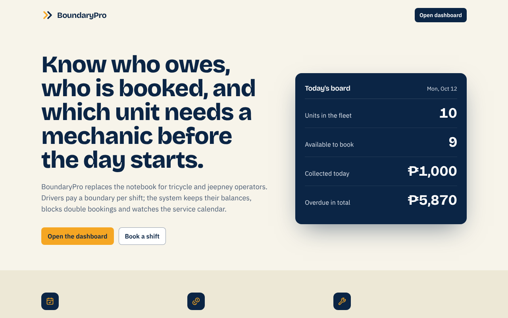

**Dashboard.** Today's shifts, collections, overdue drivers and units due for service.

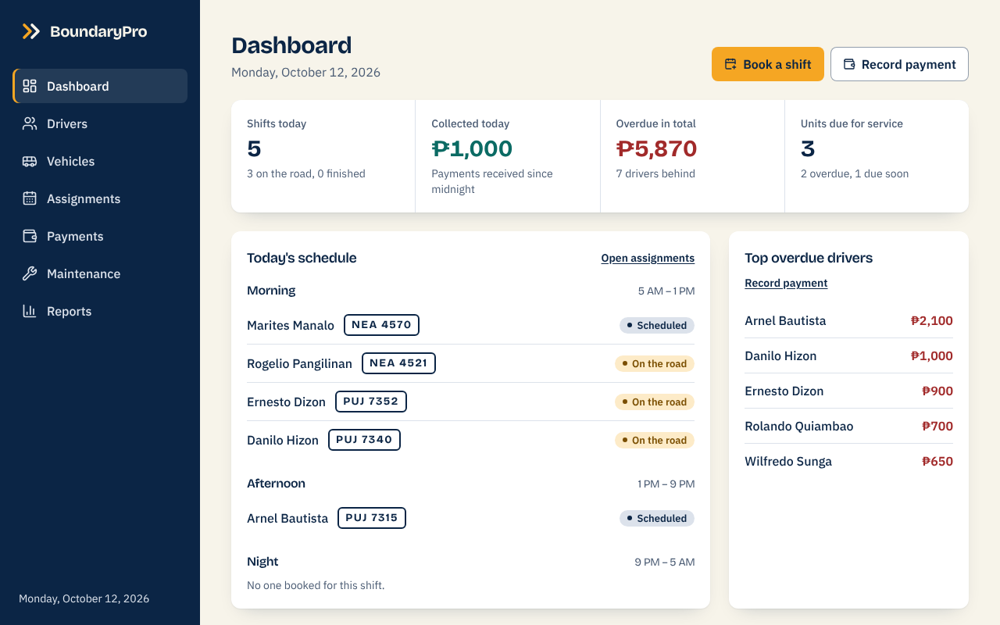

**Drivers.** Search, filter and sort, with each driver's balance. Delete asks for confirmation first.

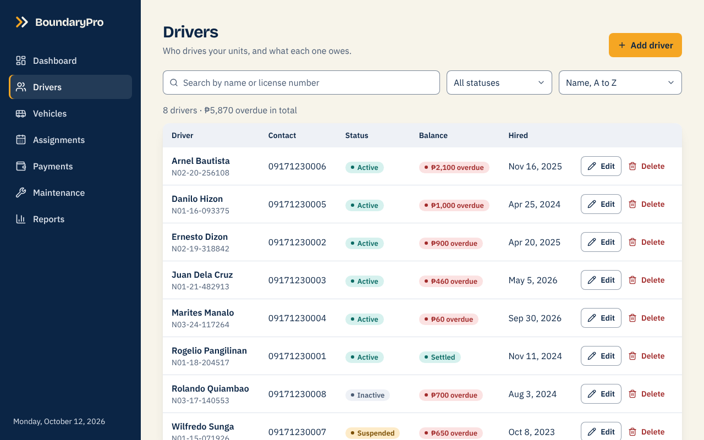

**Driver detail.** Balance, profile, a quick payment form, and the latest shifts and payments.

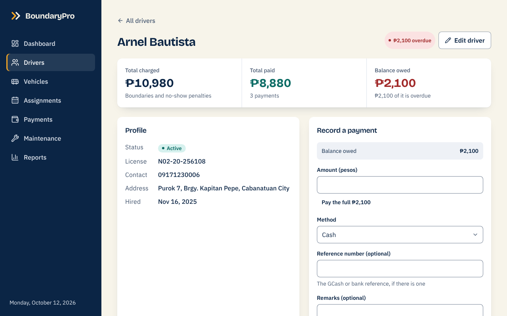

**Vehicles.** The fleet, with each unit's boundary, odometer and service status.

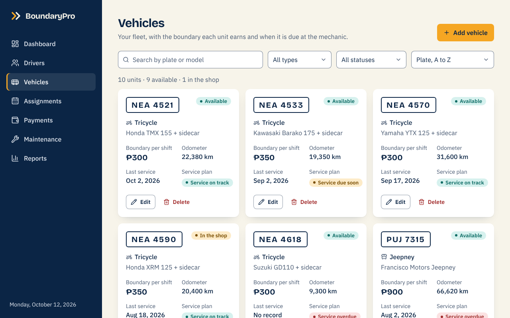

**Assignments.** One day at a time, in three shifts, with the actions each status allows.

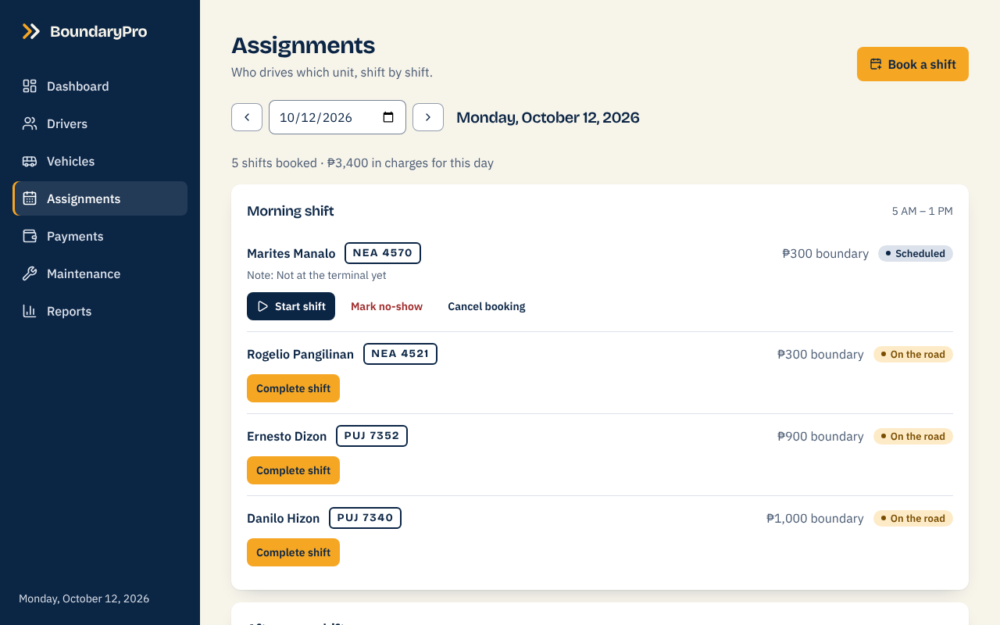

**Booking a shift.** The form asks the server while you choose, and explains why a booking is refused (here, a double booking).

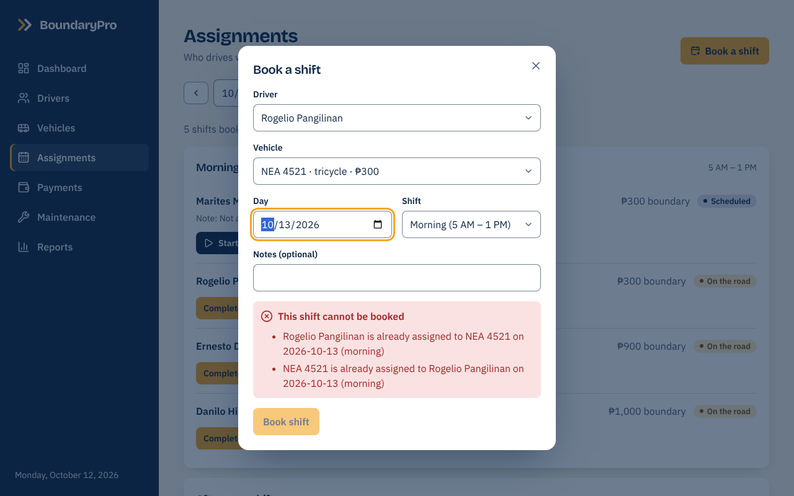

**Payments.** The ledger, with filters and a total that follows them.

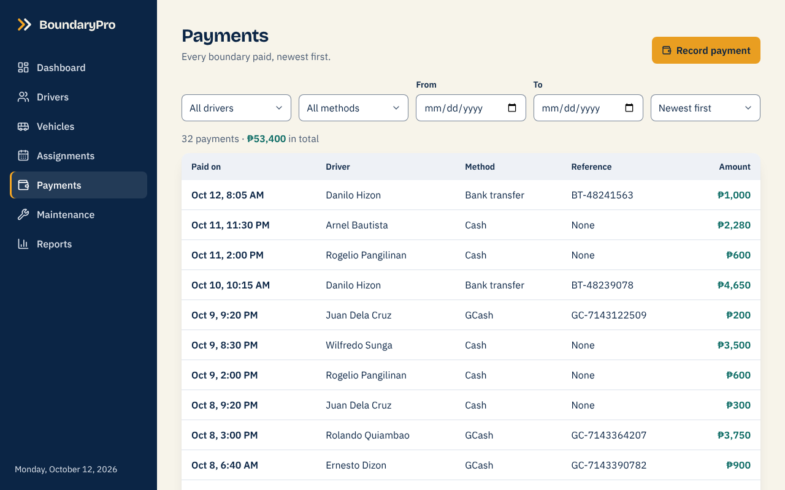

**Recording a payment.** The amount cannot be higher than what the driver owes; "Pay the full" fills it in.

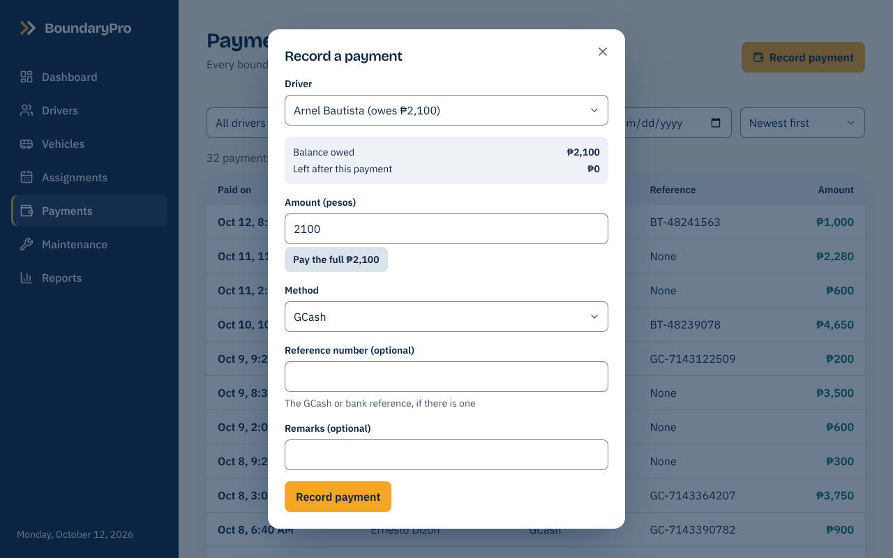

**Maintenance.** Units due for service, units in the shop, and the history of finished services.

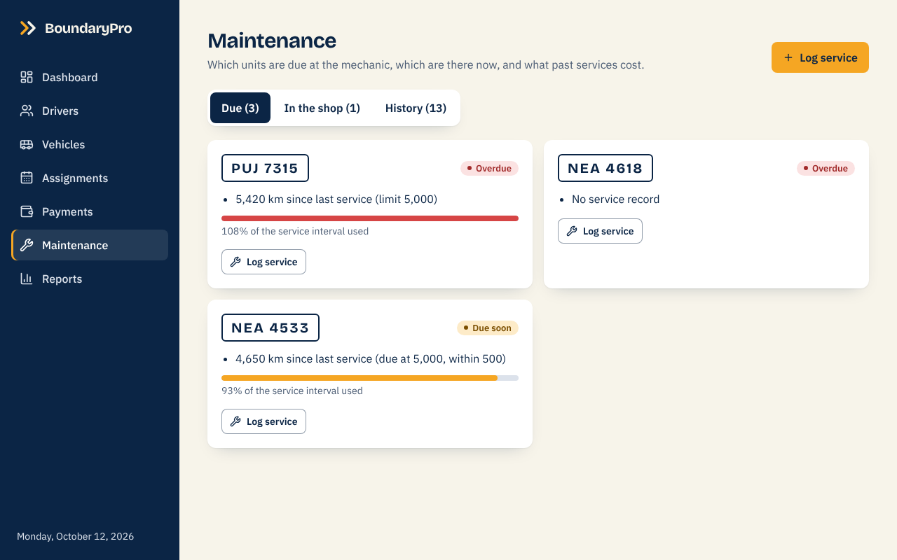

**Reports.** Figures for a date range, a chart per day or month, and the driver ranking below.

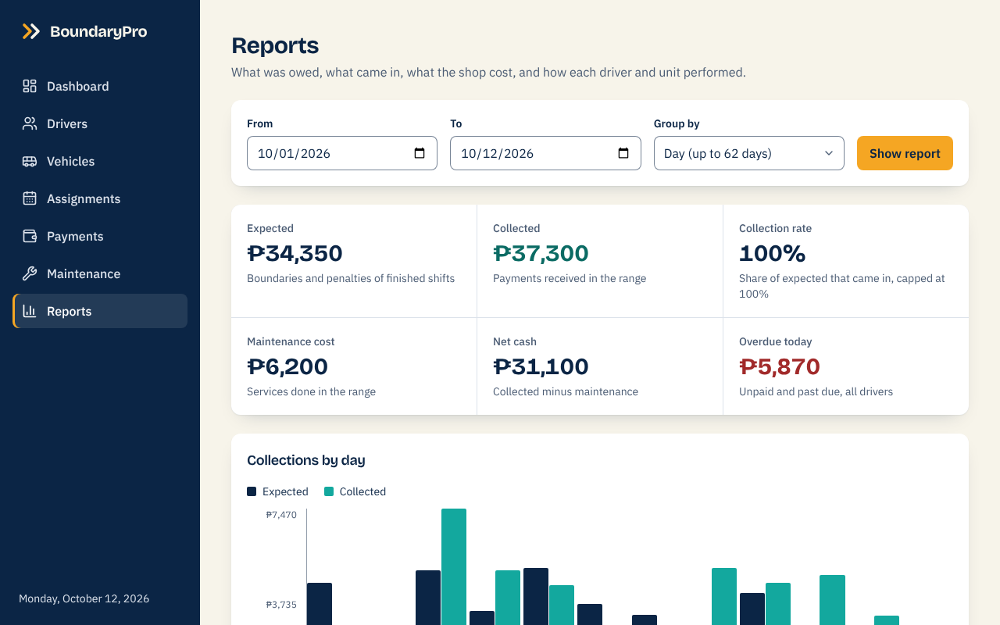

**Validation.** The same rules as the server, shown under each field before anything is sent.

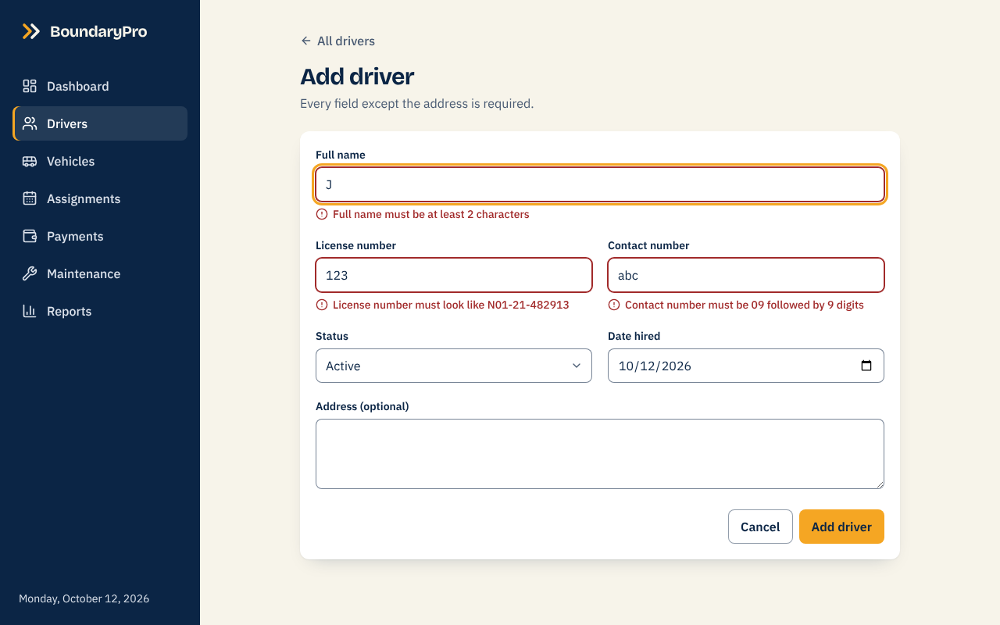

**Not found.** The server's own message is shown, with a way back.

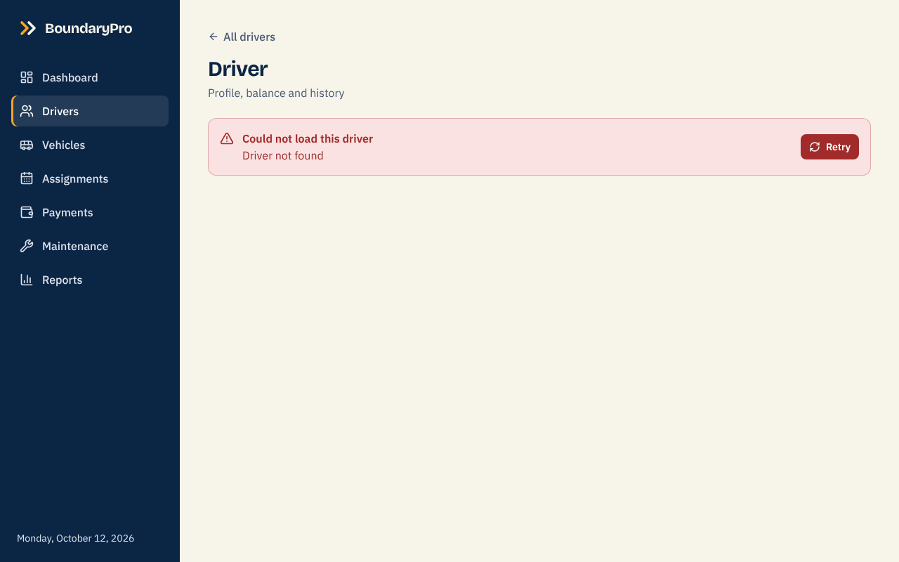

### Phone (375 px wide)

On a phone the sidebar becomes a bottom bar, tables become stacked cards, and nothing scrolls sideways.

| Dashboard | Drivers | Assignments | More menu |
|---|---|---|---|
| 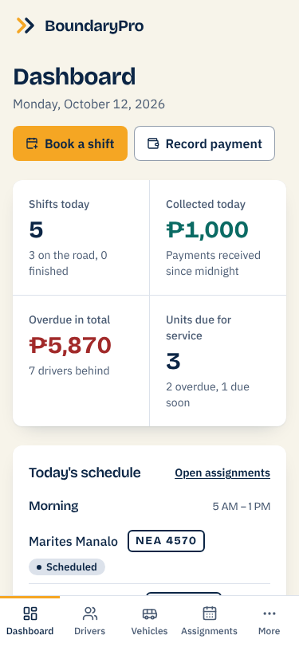 | 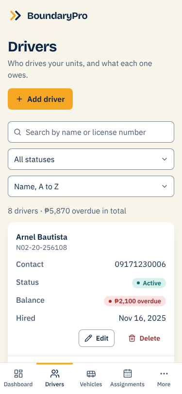 | 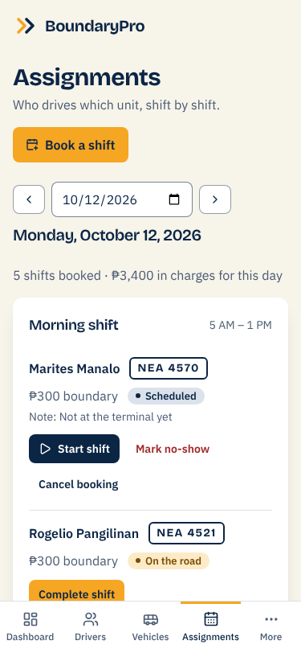 | 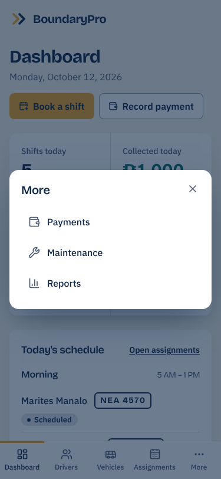 |

## Features

- **12 pages** with React Router (landing, dashboard, drivers, driver detail, driver form, vehicles, vehicle form, assignments, payments, maintenance, reports and a 404 page), reachable from 14 routes.
- **One axios instance** (`src/api/client.ts`) with the base URL from an environment variable. Every request in the app goes through it.
- **Every screen that loads data** shows a skeleton while loading, an error banner with a Retry button when the request fails, and a helpful empty state when there is nothing to show. There are no blank screens and no silent failures.
- **Eight forms** with React Hook Form and Zod: the schema lives outside the component, the type comes from `z.infer`, each field shows its own message, and the submit button is disabled while the request is running. A 400 or 409 from the server is mapped onto the matching field.
- **Live availability check.** While the booking form is filled in, it asks `POST /api/assignments/check-availability` and shows the answer with the reasons and warnings. The button stays disabled while the answer is "no".
- **Payments limited to the balance.** The form shows what the driver owes, what is left after the amount typed, and blocks an amount above the balance (the server enforces the same rule).
- **Confirmation before every destructive action:** deleting a driver or a vehicle, marking a no-show (it charges a penalty) and cancelling a booking.
- **Success feedback after every create, update and delete** as a toast that disappears by itself, and that screen readers announce.
- **Lists use `_id` as the key**, never the array index.
- **Derived values are computed while rendering**, not stored in state.
- **Custom hooks** in `src/hooks`: `useFetch` (loading, error, data, refetch), `useDebounce` (waits for the user to stop typing before searching), `useToast` and `useDocumentTitle`.
- **Manila time everywhere.** Dates are shown and compared as Manila calendar days, whatever time zone the browser uses.
- **Responsive and accessible.** Fully usable at 375 px and on a desktop with no horizontal scroll; dialogs use the native `<dialog>` element; keyboard focus is always visible; a skip link jumps to the content. An automated accessibility scan (axe-core) of every page found no violations.

## Tech stack

| Part | Technology |
|---|---|
| Build tool | Vite 5 |
| UI | React 18 with TypeScript (strict mode) |
| Routing | React Router 6 |
| Styling | Tailwind CSS 3, with the palette defined in `tailwind.config.ts` |
| Forms | React Hook Form 7 with Zod 3 (`@hookform/resolvers`) |
| HTTP | axios, in one file |
| Icons and fonts | lucide-react; Bricolage Grotesque and IBM Plex Sans, bundled with the app through Fontsource (no request to Google Fonts) |
| API | `boundarypro-server`: Node.js, Express, MongoDB Atlas with Mongoose |

## Setup

### 1. What you need

- [Node.js](https://nodejs.org) 20 or newer (check with `node -v`)
- The **API running and seeded**: follow the setup of the `boundarypro-server` repository first (a free MongoDB Atlas cluster, `npm install`, `npm run seed`, `npm run dev`). The API must answer at <http://localhost:5000/api/drivers> in a browser.

### 2. Install and run the client

```bash
git clone <this repository's URL>
cd boundarypro-client
npm install
```

The API address is read from an environment variable. The default is the server's default address, so this step is optional when the server runs on port 5000:

```bash
# macOS / Linux / Git Bash
cp .env.example .env

# Windows (Command Prompt or PowerShell)
copy .env.example .env
```

Then start the app:

```bash
npm run dev
```

Open <http://localhost:5173>. The client **must** run on port 5173: the API accepts browser requests only from `http://localhost:5173` (its `CLIENT_URL` setting). If the port is busy, Vite stops with an error instead of moving to another port, so a wrong port is never a silent problem.

### Environment variables

| Variable | Required | Meaning | Example |
|---|---|---|---|
| `VITE_API_URL` | no (default `http://localhost:5000/api`) | Address of the BoundaryPro API, including `/api` at the end | `http://localhost:5000/api` |

Vite puts every variable that starts with `VITE_` into the browser bundle, so a `.env` file of this app must never hold a secret. This one does not: it only holds a public address. The real `.env` is ignored by Git, and `.env.example` is committed. Restart `npm run dev` after changing it.

### Scripts

| Script | What it does |
|---|---|
| `npm run dev` | Starts the development server with hot reload on port 5173 |
| `npm run build` | Type-checks the whole project (`tsc`), then builds the production files into `dist/` |
| `npm run preview` | Serves the built `dist/` folder on port 5173, to check the production build |

## Try it yourself

Use a freshly seeded database (`npm run seed` in the server repository, on the day you try this). The numbers below are the ones the seed produces. Open the browser's DevTools, Network tab, to watch the requests.

| # | Do this | Expect |
|---|---|---|
| 1 | Open `/` | The landing page. "Today's board" shows 10 units, 9 available, ₱1,000 collected today and ₱5,870 overdue. |
| 2 | Click **Open the dashboard** | Shifts today 5 (3 on the road), Collected today ₱1,000, Overdue in total ₱5,870 (7 drivers behind), Units due for service 3 (2 overdue, 1 due soon). The first overdue driver is Arnel Bautista, ₱2,100. |
| 3 | Open **Drivers**; type `juan` in the search; then clear it and choose the status **Suspended** | One row (Juan Dela Cruz), then one row (Wilfredo Sunga). Clearing the filters brings back all 8 drivers. |
| 4 | Open **Arnel Bautista** | Balance owed ₱2,100, the same figure as the dashboard. His charges, shifts and payments are listed. |
| 5 | Open **Vehicles** | 10 units, 9 available, 1 in the shop. `NEA 4590` says "In the shop", `PUJ 7315` "Service overdue", `NEA 4533` "Service due soon". |
| 6 | **Validation error.** Open **Drivers, Add driver**. Type `J` as the name, `123` as the license and `abc` as the contact number, then press **Add driver** | Three messages, one under each field. No request appears in the Network tab. |
| 7 | **Create.** Fill in `Pedro Penduko`, `N05-22-123456`, `09171239999` and press **Add driver** | You return to the list. A toast says "Added Pedro Penduko". |
| 8 | **Server error on a field.** Add another driver with the same license `N05-22-123456` | The server's 409 message appears under the License field, not as a general error. |
| 9 | **Delete with confirmation.** Delete Pedro Penduko, first pressing **Cancel**, then confirming | Cancel changes nothing. Confirming shows "Deleted Pedro Penduko". |
| 10 | **Delete guard.** Delete Arnel Bautista and confirm | A red toast with the server's message: the driver has assignments or payments and cannot be deleted. |
| 11 | **Live availability.** Open **Assignments, Book a shift**. Choose Rogelio Pangilinan, vehicle `NEA 4521`, tomorrow, Morning | A red message "This shift cannot be booked" with two reasons (a double booking). **Book shift** is disabled. |
| 12 | Change the shift to **Night** | A green message "Available. This shift can be booked." Press **Book shift**: a toast confirms, and the page jumps to that day. |
| 13 | On today's board, press **Start shift** for Marites Manalo, then **Complete shift** for Rogelio Pangilinan with an end reading *lower* than the start | The server's message appears under the odometer field. With a higher reading, the toast says the boundary is now due, and the row shows Completed. |
| 14 | Press **Mark no-show** for Arnel Bautista's afternoon shift, then confirm | A toast with the penalty (the boundary is waived and a penalty is charged once). |
| 15 | **Payments limited to the balance.** Open **Payments, Record payment**, choose a driver and type an amount above what they owe | A message under the amount: the driver owes ₱X and the amount cannot be higher. Press **Pay the full ₱X**, then **Record payment**: a toast confirms, the ledger gets a new row, and the driver owes ₱0. |
| 16 | **Maintenance.** Open **Maintenance**, press **Log service** on `PUJ 7315`, keep "Send to the shop", enter a cost and save | A toast says the unit is now in the shop. The **In the shop** tab goes from 1 to 2. Press **Complete service** there: a toast says it is back on the road, and **History** grows by one. |
| 17 | Open **Reports**. Set From to a date more than 62 days before To (for example three months back) and press **Show report** with "Day" selected | A message under "Group by": group by month for ranges longer than 62 days. No request is sent. Choose **Month** and press the button again: the chart shows one pair of bars per month. |
| 18 | **Not found.** Open `/nope`, then `/drivers/000000000000000000000000` | A 404 page with links back; then an error banner "Driver not found" with a way back to the list. |
| 19 | **Error state.** Stop the API (Ctrl+C in its terminal), reload **Drivers** | A red banner "Could not load drivers" that says the server cannot be reached, with **Retry**. Start the API again and press Retry: the list appears. |
| 20 | **Phone.** In DevTools, switch on the device toolbar and choose a width of 375 px | A bottom bar with Dashboard, Drivers, Vehicles, Assignments and **More** (Payments, Maintenance, Reports). Tables are stacked cards. The page never scrolls sideways. |

## Project structure

```text
boundarypro-client/
├── .env.example               VITE_API_URL (copy to .env, never commit .env)
├── .gitignore                 node_modules, dist and .env
├── index.html                 the page Vite serves; the app mounts in #root
├── package.json
├── tailwind.config.ts         the palette, fonts, shadows and animations: the whole look is decided here
├── vite.config.ts             port 5173 (the API's CORS address), strictPort
├── tsconfig.json              TypeScript strict mode
├── docs/screenshots/          the images used in this README
├── public/favicon.svg
└── src/
    ├── main.tsx               mounts React with the router and the toast provider
    ├── App.tsx                the route table
    ├── index.css              Tailwind layers, base styles, focus ring, reduced motion
    ├── api/
    │   ├── client.ts          the ONE axios instance (axios.create with baseURL) and the error helpers
    │   ├── drivers.ts         one function per endpoint, grouped by collection:
    │   ├── vehicles.ts        drivers, vehicles, assignments, payments,
    │   ├── assignments.ts     maintenance and stats
    │   ├── payments.ts
    │   ├── maintenance.ts
    │   └── stats.ts
    ├── schemas/               Zod schemas, outside the components (driver, vehicle, assignment, payment, maintenance, report filter)
    ├── types/index.ts         the shapes of API data, and the form types made with z.infer
    ├── hooks/
    │   ├── useFetch.ts        loading, error, data and refetch for a screen
    │   ├── useDebounce.ts     waits until typing stops
    │   ├── useToast.ts        success and error messages
    │   └── useDocumentTitle.ts
    ├── utils/                 format.ts (Manila dates, pesos, kilometres), form.ts (number inputs, server field errors), labels.ts, assignments.ts
    ├── components/
    │   ├── ui/                the shared building blocks: Button, Card, Field, Input, Select, Textarea, SearchBox, Badge, StatusBadge,
    │   │                      Modal, ConfirmDialog, EmptyState, ErrorBanner, Skeleton, Toast, Table, Stat, PageHeader, PlateChip, ...
    │   ├── layout/            AppShell (the frame of every page but the landing), Sidebar, BottomNav, Brand
    │   └── forms/             forms used inside dialogs or in two places: AssignmentForm, CompleteShiftForm,
    │                          PaymentForm, ServiceForm, CompleteServiceForm
    └── pages/                 one file per screen: Landing, Dashboard, Drivers, DriverDetail, DriverForm,
                               Vehicles, VehicleForm, Assignments, Payments, Maintenance, Reports, NotFound
```

## From React to Express to MongoDB

```text
 Form (React Hook Form)
   │  the Zod schema checks every field in the browser; the messages appear under the fields
   ▼
 src/api/*.ts ──► src/api/client.ts        the one axios instance; baseURL comes from VITE_API_URL
   │
   ▼  HTTP + JSON
 Express: routes ► controllers ► services ► Mongoose models ► MongoDB Atlas      (boundarypro-server)
   │
   ▼  JSON: the data, or { "message": "...", "errors": [ { "field": "...", "message": "..." } ] }
 useFetch or the form's submit handler
   ├─ success  ► data is rendered (counts and totals are worked out right there) and a toast confirms
   └─ failure  ► 400 or 409: messages under the matching inputs
                 anything else: a toast, or an error banner with Retry where the data should be
```

**Worked example: booking a shift.**

1. The dispatcher chooses a driver, a vehicle, a day and a shift in `AssignmentForm`. Each time one of the four changes, `useFetch` calls `checkAvailability` in `src/api/assignments.ts`, which sends `POST /api/assignments/check-availability`.
2. The server's availability service checks the driver's and the vehicle's status, existing bookings and overdue balance, and answers `{ available, reasons, warnings }`. Nothing is saved. The form shows the answer in a message that screen readers announce, and keeps **Book shift** disabled while `available` is false.
3. On submit, React Hook Form runs the Zod schema (`assignment.schema.ts`): the day cannot be before today, the notes have a maximum length. Only a valid form is sent as `POST /api/assignments`.
4. The server validates again, copies the vehicle's current rate into the assignment, and Mongoose saves it. Two unique indexes in MongoDB make a double booking impossible even if two dispatchers press the button at the same moment (the server then answers 409 with the reasons).
5. On success the form closes, a toast says "Booked …", and the page jumps to the booked day, which loads again. On a 409 or 400, the server's messages appear in the form.

A few small rules keep the code easy to follow:

- Only `src/api/client.ts` imports axios. Pages never call it directly; they call a named function such as `listDrivers` or `createPayment`.
- `useFetch(fetcher, deps)` is the one way a screen loads data. It keeps the previous data on screen while a filter reloads (dimmed, `aria-busy`), ignores an answer that arrives after a newer request has started, and gives `refetch` to the Retry button and to the code that runs after a change.
- State holds only what the user chose (filters, which dialog is open). Anything that can be calculated from the data, such as a count or a total, is calculated while rendering.

## Pages and routes

| Route | Page | What it shows | API calls |
|---|---|---|---|
| `/` | Landing | Pitch and "Today's board" | `GET /vehicles`, `GET /stats/collections` |
| `/dashboard` | Dashboard | Shifts, collections, overdue drivers, units due | `GET /assignments`, `GET /stats/collections`, `GET /vehicles/maintenance-due`, `GET /drivers` |
| `/drivers` | Drivers | Search, filter, sort, balances, delete | `GET /drivers`, `DELETE /drivers/:id` |
| `/drivers/new` | DriverForm | Create form | `POST /drivers` |
| `/drivers/:id` | DriverDetail | Balance, profile, quick payment, shifts, payments | `GET /drivers/:id`, `GET /drivers/:id/balance`, `GET /assignments`, `GET /payments`, `POST /payments` |
| `/drivers/:id/edit` | DriverForm | Edit form | `GET /drivers/:id`, `PUT /drivers/:id` |
| `/vehicles` | Vehicles | Fleet cards, filters, service status, delete | `GET /vehicles`, `GET /vehicles/maintenance-due`, `DELETE /vehicles/:id` |
| `/vehicles/new` | VehicleForm | Create form | `POST /vehicles` |
| `/vehicles/:id/edit` | VehicleForm | Edit form | `GET /vehicles/:id`, `PUT /vehicles/:id` |
| `/assignments` | Assignments | One day in three shifts; book, start, complete, no-show, cancel | `GET /assignments`, `GET /drivers`, `GET /vehicles`, `POST /assignments/check-availability`, `POST /assignments`, `PATCH /assignments/:id/status` |
| `/payments` | Payments | Ledger with filters; record a payment | `GET /payments`, `GET /drivers`, `POST /payments` |
| `/maintenance` | Maintenance | Tabs: due, in the shop, history; log and complete a service | `GET /vehicles/maintenance-due`, `GET /maintenance`, `GET /vehicles`, `POST /maintenance`, `PATCH /maintenance/:id/complete` |
| `/reports` | Reports | Figures and chart for a range, driver ranking | `GET /stats/collections`, `GET /drivers/ranking` |
| `*` | NotFound | The 404 page | none |

Every page except the landing page is drawn inside `AppShell` (sidebar on a desktop, bottom bar on a phone). The page title in the browser tab changes with each page.

## Forms and validation

Each schema is defined once in `src/schemas`, outside any component, and its type comes from `z.infer` (`src/types/index.ts`). The messages match the server's own, so a mistake reads the same whether the browser or the API catches it. The server checks everything again.

| Form | Schema | Rules the browser checks |
|---|---|---|
| Add / edit driver | `driver.schema.ts` | Name 2 to 80 characters; license like `N01-21-482913` (typed in lower case is accepted); contact `09` + 9 digits; address up to 150; hire date not in the future |
| Add / edit vehicle | `vehicle.schema.ts` | Plate 3 letters + 3 or 4 digits; boundary 100 to 2000 pesos; odometer from 0; service interval 500 to 20000 km and 7 to 365 days; whole numbers only |
| Book a shift | `assignment.schema.ts` | Driver, vehicle and shift chosen; day not before today; notes up to 200 characters |
| Complete a shift | `assignment.schema.ts` | End odometer is a whole number from 0 (the server also refuses a reading below the start reading, shown under the field) |
| Record a payment | `payment.schema.ts` | Driver chosen; 1 to 100000 whole pesos; reference up to 40, remarks up to 200. The balance limit is checked while rendering and by the server |
| Log a service | `maintenance.schema.ts` | Vehicle chosen; cost and odometer present; next due odometer above the odometer; next due date after the service date |
| Complete a service | `maintenance.schema.ts` | Same, without the kind of service (fixed when the service started) |
| Report filter | `reportFilter.schema.ts` | Both dates present; start not after end; at most 366 days; "Day" grouping at most 62 days |

All forms use `noValidate`, so the messages come from Zod and look the same in every browser. Number boxes go through `numberOrBlank` (`src/utils/form.ts`) so an empty box gives "… is required" instead of a confusing "must be a number". When the server answers 400 or 409 with an `errors` list, `showServerErrors` puts each message under its field; when it sends none, a toast shows the general message.

## Design

The look is decided once, in `tailwind.config.ts`. The theme **replaces** Tailwind's colours instead of extending them, so only the BoundaryPro palette exists and no page can drift off it.

| Colour | Hex | Used for |
|---|---|---|
| Navy | `#0B2545` | Headings, sidebar, primary buttons, plate chips |
| Amber | `#F5A623` | The one key action on a screen, the active-page marker |
| Teal | `#13A89E` | Success, "available", money that came in |
| Cream | `#F7F4EA` | Page background |
| Danger | `#D64545` | Overdue, errors, destructive actions |

Each colour has a light and a dark shade for badges and alerts. Amber and teal are too pale to be text on a light background, so their text uses the dark shade; the destructive buttons use the dark red so white text keeps a readable contrast.

- **Type:** Bricolage Grotesque for headings, IBM Plex Sans for text and numbers, with tabular digits so amounts line up in columns.
- **Consistency:** one card style (`rounded-xl`, one soft navy-tinted shadow), one set of buttons, inputs, badges and dialogs used by every page (`src/components/ui`).
- **A theme from the subject:** vehicle plates appear as plate chips, and the landing page shows "Today's board" that flips its numbers once like a departure board (not when the system asks for reduced motion).
- **Phones:** the sidebar becomes a bottom bar with "More"; tables become stacked cards with a label beside each value; grids collapse to one column; buttons and inputs are 44 px tall (36 px for the small buttons inside cards).
- **Accessibility:** visible focus ring, skip link, labelled inputs with messages tied to them (`aria-describedby`, `aria-invalid`), live regions for toasts and the availability message, native dialogs that trap focus and close with Esc, and colour is never the only signal (badges have text and a dot).

## API documentation

This table is repeated from the README of the `boundarypro-server` repository, so each repository can be read on its own.

Base URL: `http://localhost:5000/api`. **Processing** marks the six endpoints that compute something beyond plain CRUD. The sample requests and responses below are real: they were copied from a server running on a freshly seeded database, by following the request test list in the server README. Long responses are shortened with `…`.

Conventions:

- Bodies are JSON, so send the header `Content-Type: application/json` with `POST`, `PUT` and `PATCH`.
- Ids are 24-character MongoDB ObjectIds. A malformed id is a 400 (`Invalid ID`), an unknown one a 404.
- Money is in whole pesos.
- Dates you send (`date`, `from`, `to`) are written `YYYY-MM-DD` and mean a day in Manila. Stored dates come back as ISO timestamps in UTC, so an assignment on 12 October in Manila appears as `2026-10-11T16:00:00.000Z`. The processing endpoints return plain Manila days (`2026-10-12`).
- Lists are plain arrays and are not paginated. Fields a client may not write (for example `holdsSlot` of an assignment or `lastServiceDate` of a vehicle) are ignored if sent.
- The samples were captured when the seed ran on 2026-10-10, the day the proposal's examples use. Your dates move with the day you seed; the amounts, scores and rates do not.

| # | Method | Path | Purpose | Sample request | Sample response |
|---|--------|------|---------|----------------|-----------------|
| 1 | GET | `/api/drivers` | List drivers. Query: `q` (name, license or contact number), `status`, `sort` (`fullName` default, `dateHired`, `status`; `-` in front = descending). Every driver carries a computed `balance` and `overdueAmount`. Errors: 400. | `GET /api/drivers?q=juan&sort=fullName` | **200**<br>`[ { "_id": "6650c1f2a9b3c4d5e6f70811", "fullName": "Juan Dela Cruz", "status": "active", "balance": 460, "overdueAmount": 460, … } ]` |
| 2 | GET | `/api/drivers/ranking` | **Processing.** Rank drivers by punctuality score. Query: `limit` (10, max 50), `minAssignments` (3), `includeInactive` (false). Errors: 400. | `GET /api/drivers/ranking` | **200**<br>`{ "asOf": "2026-10-10", "ranked": [ { "rank": 1, "fullName": "Rogelio Pangilinan", "score": 100, "onTimeRate": 1, "attendanceRate": 1, "clearanceRate": 1, … }, { "rank": 2, "fullName": "Ernesto Dizon", "score": 89, "onTimeRate": 0.86, "attendanceRate": 1, "clearanceRate": 0.86, … }, … ], "unranked": [ { "fullName": "Marites Manalo", "reason": "Only 2 chargeable assignments (minimum is 3)", … } ] }` |
| 3 | GET | `/api/drivers/:id` | Get one driver. Errors: 400 (bad id), 404. | `GET /api/drivers/6650c1f2a9b3c4d5e6f70811` | **200**<br>`{ "_id": "6650c1f2a9b3c4d5e6f70811", "fullName": "Juan Dela Cruz", "licenseNumber": "N01-21-482913", "contactNumber": "09171230003", "status": "active", … }` |
| 4 | POST | `/api/drivers` | Create a driver. Errors: 400 (validation), 409 (license already used). | `POST /api/drivers`<br>`{ "fullName": "Pedro Penduko", "licenseNumber": "N05-22-123456", "contactNumber": "09171239999", "address": "Brgy. Sumacab Este, Cabanatuan City" }` | **201**<br>`{ "_id": "6ac9b841e349854fed9c7235", "fullName": "Pedro Penduko", "licenseNumber": "N05-22-123456", "status": "active", "dateHired": "2026-10-10T04:00:01.173Z", … }` |
| 5 | PUT | `/api/drivers/:id` | Update a driver; fields you leave out keep their value. Errors: 400, 404, 409. | `PUT /api/drivers/6ac9b841e349854fed9c7235`<br>`{ "contactNumber": "09171230000", "status": "suspended" }` | **200**<br>`{ "_id": "6ac9b841e349854fed9c7235", "fullName": "Pedro Penduko", "contactNumber": "09171230000", "status": "suspended", … }` |
| 6 | DELETE | `/api/drivers/:id` | Delete a driver. Blocked when the driver has assignments or payments (BR9). Errors: 400, 404, 409. | `DELETE /api/drivers/6ac9b841e349854fed9c7235` | **200**<br>`{ "message": "Driver deleted" }` |
| 7 | GET | `/api/drivers/:id/balance` | **Processing.** Running balance, overdue amount and charge-by-charge breakdown (FIFO). Errors: 400, 404. | `GET /api/drivers/6650c1f2a9b3c4d5e6f70811/balance` | **200**<br>`{ "driverId": "6650c1f2a9b3c4d5e6f70811", "fullName": "Juan Dela Cruz", "asOf": "2026-10-10", "totalCharged": 960, "totalPaid": 500, "balance": 460, "overdueAmount": 460, "overdueCount": 3, "charges": [ { "date": "2026-10-05", "type": "boundary", "amount": 300, "paid": 300, "outstanding": 0, "dueDate": "2026-10-06", "overdue": false, … }, { "date": "2026-10-06", "type": "boundary", "amount": 300, "paid": 200, "outstanding": 100, "dueDate": "2026-10-07", "overdue": true, … }, … ] }` |
| 8 | GET | `/api/vehicles` | List vehicles. Query: `type`, `status`, `q` (plate or model), `sort` (`plateNumber` default, `type`, `status`, `boundaryRate`, `odometerKm`). Errors: 400. | `GET /api/vehicles?type=tricycle&status=available&sort=-boundaryRate` | **200**<br>`[ { "_id": "6ac9b8407e4076de6e52a9f5", "plateNumber": "NEA 4533", "type": "tricycle", "boundaryRate": 350, "odometerKm": 19350, "status": "available", … }, { "_id": "6650c1f2a9b3c4d5e6f70921", "plateNumber": "NEA 4521", "type": "tricycle", "boundaryRate": 300, "odometerKm": 22380, "status": "available", … }, … ]` |
| 9 | GET | `/api/vehicles/maintenance-due` | **Processing.** Vehicles that are overdue or due soon for service. Query: `withinDays` (14), `withinKm` (500). Errors: 400. | `GET /api/vehicles/maintenance-due` | **200**<br>`{ "asOf": "2026-10-10", "count": 3, "vehicles": [ { "plateNumber": "PUJ 7315", "severity": "overdue", "kmSinceService": 5420, "daysSinceService": 71, "reasons": [ "5,420 km since last service (limit 5,000)" ], … }, { "plateNumber": "NEA 4618", "severity": "overdue", "kmSinceService": null, "daysSinceService": null, "reasons": [ "No service record" ], … }, … ] }` |
| 10 | GET | `/api/vehicles/:id` | Get one vehicle. Errors: 400, 404. | `GET /api/vehicles/6650c1f2a9b3c4d5e6f70921` | **200**<br>`{ "_id": "6650c1f2a9b3c4d5e6f70921", "plateNumber": "NEA 4521", "type": "tricycle", "boundaryRate": 300, "odometerKm": 22380, "status": "available", … }` |
| 11 | POST | `/api/vehicles` | Create a vehicle. The plate is stored as `ABC 1234`, so `nea4700` and `NEA 4700` are the same plate. Errors: 400, 409. | `POST /api/vehicles`<br>`{ "plateNumber": "NEA 4700", "type": "tricycle", "model": "Honda TMX 155 + sidecar", "boundaryRate": 320 }` | **201**<br>`{ "_id": "6ac9b841e349854fed9c7243", "plateNumber": "NEA 4700", "boundaryRate": 320, "odometerKm": 0, "status": "available", … }` |
| 12 | PUT | `/api/vehicles/:id` | Update a vehicle. Errors: 400, 404, 409. | `PUT /api/vehicles/6ac9b841e349854fed9c7243`<br>`{ "boundaryRate": 350, "odometerKm": 120 }` | **200**<br>`{ "_id": "6ac9b841e349854fed9c7243", "plateNumber": "NEA 4700", "boundaryRate": 350, "odometerKm": 120, "status": "available", … }` |
| 13 | DELETE | `/api/vehicles/:id` | Delete a vehicle. Blocked when it has assignments or maintenance records (BR9). Errors: 400, 404, 409. | `DELETE /api/vehicles/6ac9b841e349854fed9c7243` | **200**<br>`{ "message": "Vehicle deleted" }` |
| 14 | GET | `/api/assignments` | List assignments. Query: `from`, `to` (YYYY-MM-DD, both days included), `shift`, `status`, `driver`, `vehicle` (ids), `sort` (`date` or `-date`). Errors: 400. | `GET /api/assignments?from=2026-10-10&to=2026-10-10&shift=morning` | **200**<br>`[ { "_id": "6650c1f2a9b3c4d5e6f70a07", "driver": { "fullName": "Marites Manalo", … }, "vehicle": { "plateNumber": "NEA 4570", … }, "date": "2026-10-09T16:00:00.000Z", "shift": "morning", "status": "scheduled", "boundaryDue": 300, … }, { "_id": "6ac9b8407e4076de6e52aa1e", "driver": { "fullName": "Rogelio Pangilinan", … }, "vehicle": { "plateNumber": "NEA 4521", … }, "date": "2026-10-09T16:00:00.000Z", "shift": "morning", "status": "active", "boundaryDue": 300, … }, … ]` |
| 15 | GET | `/api/assignments/:id` | Get one assignment with its driver and vehicle details. Errors: 400, 404. | `GET /api/assignments/6650c1f2a9b3c4d5e6f70a07` | **200**<br>`{ "_id": "6650c1f2a9b3c4d5e6f70a07", "driver": { "fullName": "Marites Manalo", "licenseNumber": "N03-24-117264", … }, "vehicle": { "plateNumber": "NEA 4570", "boundaryRate": 300, … }, "shift": "morning", "status": "scheduled", "boundaryDue": 300, … }` |
| 16 | POST | `/api/assignments` | Create an assignment after running the availability rules; copies the vehicle's rate into `boundaryDue` (BR1). Errors: 400, 404, 409 (with `reasons`). | `POST /api/assignments`<br>`{ "driverId": "6650c1f2a9b3c4d5e6f70811", "vehicleId": "6650c1f2a9b3c4d5e6f70921", "date": "2026-10-12", "shift": "afternoon", "notes": "Barangay fiesta trips" }` | **201**<br>`{ "_id": "6ac9b841e349854fed9c7258", "driver": { "fullName": "Juan Dela Cruz", … }, "vehicle": { "plateNumber": "NEA 4521", … }, "shift": "afternoon", "status": "scheduled", "boundaryDue": 300, "holdsSlot": true, … }` |
| 17 | POST | `/api/assignments/check-availability` | **Processing.** Check a driver, vehicle, date and shift without saving anything. Errors: 400 (including `PAST_DATE`), 404. | `POST /api/assignments/check-availability`<br>`{ "driverId": "6650c1f2a9b3c4d5e6f70811", "vehicleId": "6650c1f2a9b3c4d5e6f70921", "date": "2026-10-12", "shift": "morning" }` | **200**<br>`{ "available": false, "reasons": [ { "code": "VEHICLE_BOOKED", "message": "NEA 4521 is already assigned to Rogelio Pangilinan on 2026-10-12 (morning)" } ], "warnings": [ { "code": "DRIVER_OVERDUE", "message": "Juan Dela Cruz has 460 pesos overdue, at least one day of boundary" } ] }` |
| 18 | PATCH | `/api/assignments/:id/status` | **Processing.** Move an assignment through its lifecycle; applies the no-show penalty once and updates the odometer. Errors: 400, 404. | `PATCH /api/assignments/6650c1f2a9b3c4d5e6f70a07/status`<br>`{ "status": "no-show" }` | **200**<br>`{ "message": "Marked as no-show. Penalty of 60 pesos charged; boundary waived.", "assignment": { "_id": "6650c1f2a9b3c4d5e6f70a07", "status": "no-show", "boundaryDue": 0, "penaltyFee": 60, "holdsSlot": false, … } }` |
| 19 | GET | `/api/payments` | List payments. Query: `driver` (id), `method`, `from`, `to`, `sort` (`-paidAt` default, `paidAt`, `amountPaid`). Errors: 400. | `GET /api/payments?driver=6650c1f2a9b3c4d5e6f70811&sort=paidAt` | **200**<br>`[ { "_id": "6ac9b8407e4076de6e52aa8c", "driver": { "fullName": "Juan Dela Cruz", … }, "amountPaid": 300, "method": "cash", "paidAt": "2026-10-06T13:20:00.000Z", … }, { "_id": "6ac9b8407e4076de6e52aa8d", "driver": { "fullName": "Juan Dela Cruz", … }, "amountPaid": 200, "method": "gcash", "paidAt": "2026-10-07T13:20:00.000Z", "referenceNo": "GC-7143122509", … } ]` |
| 20 | POST | `/api/payments` | Record a payment. It cannot be larger than the driver's outstanding balance (BR6). Errors: 400, 404. | `POST /api/payments`<br>`{ "driver": "6650c1f2a9b3c4d5e6f70811", "amountPaid": 200, "method": "gcash", "referenceNo": "GC-7144001122", "remarks": "Partial payment" }` | **201**<br>`{ "_id": "6ac9b841e349854fed9c728e", "driver": { "fullName": "Juan Dela Cruz", … }, "amountPaid": 200, "method": "gcash", "paidAt": "2026-10-10T04:00:01.500Z", "referenceNo": "GC-7144001122", … }` |
| 21 | GET | `/api/maintenance` | List maintenance records. Query: `vehicle` (id), `status`, `type`, `sort` (`-serviceDate` default, `serviceDate`, `cost`). Errors: 400. | `GET /api/maintenance?status=in-progress` | **200**<br>`[ { "_id": "6ac9b8407e4076de6e52aa0a", "vehicle": { "plateNumber": "NEA 4590", … }, "type": "brakes", "cost": 1200, "status": "in-progress", "serviceDate": "2026-10-08T16:00:00.000Z", … } ]` |
| 22 | POST | `/api/maintenance` | Log a service. In progress puts the vehicle under maintenance (BR8). Errors: 400, 404, 409. | `POST /api/maintenance`<br>`{ "vehicle": "6ac9b8407e4076de6e52a9fb", "type": "general-service", "description": "First service", "cost": 700, "odometerKm": 9320 }` | **201**<br>`{ "_id": "6ac9b841e349854fed9c729b", "vehicle": { "plateNumber": "NEA 4618", … }, "type": "general-service", "cost": 700, "status": "in-progress", "odometerKm": 9320, … }` |
| 23 | PATCH | `/api/maintenance/:id/complete` | Finish a service: the vehicle becomes available and its last service date and odometer are updated. Errors: 400, 404. | `PATCH /api/maintenance/6ac9b841e349854fed9c729b/complete`<br>`{ "cost": 750, "nextDueOdometerKm": 14300 }` | **200**<br>`{ "_id": "6ac9b841e349854fed9c729b", "vehicle": { "plateNumber": "NEA 4618", … }, "status": "completed", "cost": 750, "nextDueOdometerKm": 14300, … }` |
| 24 | GET | `/api/stats/collections` | **Processing.** Totals, collection rate, best and worst vehicles and a day or month series. Query: `from`, `to` (default: 1st of this month to today), `groupBy` (`day` or `month`). Errors: 400. | `GET /api/stats/collections?from=2026-09-27&to=2026-10-10` | **200**<br>`{ "range": { "from": "2026-09-27", "to": "2026-10-10", "groupBy": "day" }, "expected": 42350, "collected": 38900, "collectionRate": 91.9, "maintenanceCost": 6200, "netCash": 32700, "overdueTotal": 5870, "topVehicle": { "plateNumber": "PUJ 7340", "revenue": 8000, … }, "lowestVehicle": { "plateNumber": "NEA 4570", "revenue": 900, … }, "idleVehicles": [], "series": [ { "period": "2026-09-27", "expected": 4000, "collected": 1600 }, { "period": "2026-09-28", "expected": 4000, "collected": 0 }, … ] }` |

Body field names follow the collection: `POST /api/assignments` and `check-availability` use `driverId` and `vehicleId`; `POST /api/payments` uses `driver` (and an optional `assignment`); `POST /api/maintenance` uses `vehicle`.

## Known limitations

- **No login or roles.** Authentication, online payments, file uploads and deployment are out of scope. Anyone who can open the app can use every screen.
- **Nothing refreshes by itself.** A screen loads its data when it opens, and again after your own changes and when you change a filter. If someone else changes a record, you see it after you reload the page.
- **No pagination.** Lists show every matching record, because the API returns plain arrays. The driver detail page shows only the latest 8 shifts and payments; the full ledger is on the Payments page.
- **One day at a time.** Assignments shows a single day. There is no week or month calendar.
- **Lists reload after each change.** After a create, update or delete, the list is requested again instead of being edited in memory. It is simple and always shows what the server holds, at the cost of one extra request.
- **Manila time only.** Dates are shown and compared as Manila calendar days (the same rule as the API), so the app is not meant for several time zones.
- **Port 5173 is required.** The API's CORS setting accepts only `http://localhost:5173`. To serve the client from another address, change `CLIENT_URL` in the server's `.env` too.
- **A unit cannot be put in the shop from the vehicle form.** The status "In the shop" is set only by logging a service on the Maintenance page, and removed by completing it (rule BR8). The vehicle form offers Available and Retired.
- **An unknown id shows an error banner, not the 404 page.** `/drivers/<an id that does not exist>` shows the server's "Driver not found" in the banner, with a link back to the list. Addresses the app does not know at all (for example `/nope`) do show the 404 page.
- **The collection rate never goes above 100%.** The API caps it so that old debts paid in the range cannot push it over, which means Collected can be larger than Expected in the same report.
- **The payment limit uses the balance on screen.** The form limits the amount to the balance it loaded. The server checks the balance again (BR6) and has the final word, for example if someone else recorded a payment in between.
- **The chart is plain CSS bars.** Each bar pair has a text label and a hover label, and "Show the numbers" gives the same figures as a table, but there is no zoom and no click-through.
- **Testing was limited.** The app was checked in Chromium at 375 px and 1280 px wide, by keyboard, and with an automated accessibility scan (axe-core). It was not tested in Safari or Firefox, with a screen reader, or on a real phone. There are no automated tests in this repository: the "Try it yourself" list above is the test list.
- **Not deployed.** The app runs locally against a local API. `npm run build` produces the static files in `dist/`, but hosting and a production API address are not set up.
